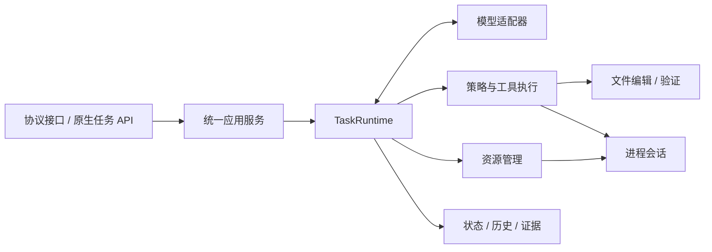

# MiniHarness

**基于 C# / .NET 9 的持久任务 Agent Harness。**

MiniHarness 将模型、工具和外部进程接入同一个任务运行内核，提供执行控制、状态记录与证据驱动的完成判定。面向希望理解和构建 Coding Agent 的开发者，也可作为实现自定义 Harness 的参考。

本文介绍 V0～V3 的能力与使用边界。V3 在 V2 基线上增强上下文与宿主恢复，继续使用同一任务运行内核。

> Agent = Model + Harness。模型选择行动，Harness 约束执行并记录真实结果。

[架构总览](docs/design/architecture.md) · [运行内核](docs/design/v0-runtime.md) · [编码闭环](docs/design/v1-coding.md) · [长任务与进程](docs/design/v2-processes.md)

## 核心能力

| 能力 | 内容 |
| --- | --- |
| 持久任务 | 跨轮输入、累计预算、审批、暂停、取消、命令去重与检查点 |
| 编码闭环 | 工作区内定位和读取、带版本前置条件的编辑、变更账本、构建/测试证据 |
| 长时间运行 | 受控后台进程、增量输出、stdin、持久等待、自动唤醒与中途纠正 |
| 上下文与恢复 | 完整交互分组、自动/显式摘要、模型输入重建、重启分类与受控继续，保留原历史和累计成本 |
| 协议接入 | Chat Completions、Responses 与原生任务 API；对外协议和上游协议独立选择 |

模型调用、工具执行、资源管理和完成判定共享任务身份与控制规则。Coding 和 Processes 能力由宿主显式开启；程序执行范围由工作区授权和命令 profile 决定。

Context 自动摘要默认关闭；Recovery 默认只分类，不自动花费模型额度。摘要与业务推理共用预算，未知费用和副作用必须核对，摘要不能替代权限或验证证据。

## 架构



- **一个执行内核**：所有任务入口共享初始化、预算、状态转换和完成规则。
- **先记录，再行动**：副作用开始前保存意图；结果未知时进入核实，避免盲目重放。
- **寿命与连接分离**：任务和进程不依赖某一次 HTTP 连接存活。
- **完成需要依据**：配置了验证要求的任务，必须具有当前工作区版本的通过证据；活资源也需要确认收尾。

详细职责、状态模型和设计取舍见[架构总览](docs/design/architecture.md)。

## 快速开始

需要 [.NET 9 SDK](global.json)。项目使用 C# 10，无第三方 NuGet 包依赖。后台进程能力要求 Windows Job 支持。

在仓库根目录设置上游模型配置，将占位符替换为实际值：

```powershell
$env:Model__BaseUrl = "https://your-provider.example/v1"
$env:Model__ApiKey = "<API_KEY>"
$env:Model__Model = "<MODEL_ID>"
$env:Model__Protocol = "ChatCompletions" # 或 Responses

dotnet build MiniHarness.sln
dotnet run --project src/MiniHarness.Server --no-launch-profile -- --urls http://127.0.0.1:5080
```

`--no-launch-profile` 避免本地开发 profile 覆盖监听地址。服务启动后，在另一终端发送请求：

```powershell
$body = @{
    model = "mini-agent"
    messages = @(@{ role = "user"; content = "请简要说明你可以协助什么。" })
} | ConvertTo-Json -Depth 4

Invoke-RestMethod -Uri "http://127.0.0.1:5080/v1/chat/completions" `
    -Method Post -ContentType "application/json; charset=utf-8" `
    -Body ([Text.Encoding]::UTF8.GetBytes($body))
```

`mini-agent` 是对外服务模型别名，与上游 `Model:Model` 分开配置。上述请求适用于未设置服务访问密钥的本地配置；若设置了 `Server:ApiKey`，请求需携带对应 Bearer token。

## 配置与接口

统一配置见 [appsettings.json](src/MiniHarness.Server/appsettings.json)。环境变量使用双下划线表示配置层级，例如 `Server__WorkspaceRoot`。

| 配置节 | 作用 |
| --- | --- |
| `Model` | 上游地址、密钥、模型、协议和传输限制 |
| `Server` | 对外别名、访问密钥、请求期限、工作区与断连取消策略 |
| `Harness` | 模型/工具调用预算、累计用量、上下文与输出限制 |
| `Storage` | 任务检查点位置 |
| `Coding` | 编码工具开关、授权、验证 profile 与必需证据 |
| `Processes` | 后台进程开关、宿主 profile、输入输出及生命周期限制 |
| `Context` | 自动摘要、近期原文、尺寸与调用上限、检查点和历史查询限制 |
| `Recovery` | Manual/Safe 恢复、并发与重试限制、可信核对授权 |

模型配置未显式设置时，也可整组提供 `CODING_PLAN_URL`、`CODING_PLAN_APIKEY`、`CODING_PLAN_MODEL`；上游协议仍由 `Model:Protocol` 选择。相对存储路径按服务内容根目录解析，需要固定位置时使用绝对路径。

编码任务需设置 `Server:WorkspaceRoot` 并开启 `Coding:Enabled`。需要测试门禁时，同时声明验证 profile 和 `Coding:RequiredVerification`。后台进程另行开启 `Processes:Enabled` 并声明 profile，其状态目录需位于源码工作区外。

| API | 用途 | 示例 |
| --- | --- | --- |
| `/v1/chat/completions`、`/v1/responses` | 文本与函数调用协议入口 | [协议请求](examples/requests.http) |
| `/agent/tasks/commands` | 持久提交、继续、审批、取消与纠正 | [任务命令](examples/task-commands.http) |
| `/agent/tasks/{id}`、`/agent/tasks/{id}/events` | 查询任务与观察进度 | [任务命令](examples/task-commands.http) |
| `/agent/tasks/{id}/resources/{resourceId}/output` | 按游标读取进程输出 | [进程交互](examples/process-tasks.http) |
| `/agent/tasks/{id}/recovery`、`context`、`history`、`failure` | 只读恢复、上下文、原历史和后台停止诊断 | [V3 请求](examples/context-recovery.http) |

需要保持同一任务和累计预算时使用原生任务 API。Responses 的 `previous_response_id` 表示历史分支，不等同于继续原任务。

## 设计文档

| 文档 | 重点 |
| --- | --- |
| [架构总览](docs/design/architecture.md) | 模块依赖、数据权威性、执行路由与演进原则 |
| [V0：持久任务运行内核](docs/design/v0-runtime.md) | Task/Turn/Step/Operation、状态转换、审批、幂等与故障语义 |
| [V1：受控修改与版本化证据](docs/design/v1-coding.md) | 工作区边界、编辑前置条件、变更归属和证据完成策略 |
| [V2：长任务与进程生命周期](docs/design/v2-processes.md) | 资源所有权、持久等待、输入输出、纠正与取消 |
| [V3：上下文与恢复](docs/design/v3-context-recovery.md) | 模型投影、摘要权威边界、统一成本和安全恢复 |

## 开发与测试

上下文投影、摘要成本与恢复边界见 [V3 设计](docs/design/v3-context-recovery.md)。

源码位于 [src](src)，场景测试位于 [tests](tests)，请求及样例工程位于 [examples](examples)。

```powershell
# 构建并执行全量离线测试
.\scripts\verify.ps1
```

测试覆盖模型与协议、命令控制、文件操作、真实进程和持久化故障。外部模型测试位于 [MiniHarness.LiveTests](tests/MiniHarness.LiveTests)，需真实服务配置并会消耗模型额度，不由默认离线命令触发。

## 适用范围

- 面向单宿主、共享信任域与受信任工程，当前不提供 OS 沙箱、多租户隔离或分布式调度。
- 支持文本与函数调用协议子集；模型输出 SSE 为缓冲式，实时任务进度使用原生事件接口。
- 文件修改采用创建和唯一文本替换，不提供语义重构、多文件事务或自动 Git 提交。
- 后台进程采用 Windows Job 管理；不提供 PTY、任意 shell 或跨宿主重启无缝接管。
- 上下文压缩保留原历史，不缩小整个检查点；固定部分超限、摘要无收益或预算不足时仍会受控停止。尚无向量检索、跨供应商原生项迁移或任意状态自动恢复。
