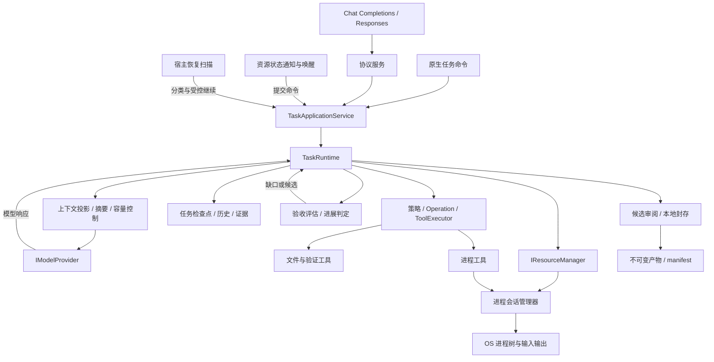

# 架构总览

[项目入口](../../README.md) · [V0 运行内核](v0-runtime.md) · [V1 编码闭环](v1-coding.md) · [V2 长任务与进程](v2-processes.md) · [V3 上下文与恢复](v3-context-recovery.md) · [V4 可验收交付](v4-delivery.md)

设计范围：V0～V4 的共同架构。版本专题按能力层次展开，本文说明贯穿这些能力的职责、执行流程与演进约束。

## 设计目标

MiniHarness 将语言模型接入一个持久、可控制的任务执行环境。模型负责解释目标和提出行动；程序负责决定行动是否允许执行、记录实际结果、限制资源消耗，并判断何时能够完成任务。

这一分工解决的核心问题是：模型输出具有不确定性，文件修改、进程启动和外部调用却会留下真实后果。运行系统必须在模型出错、用户改变要求、调用超时和宿主中断时，仍能解释“发生了什么、还有什么不确定、下一步允许做什么”。

本文及 V0～V4 专题说明长期有效的职责和取舍，不逐条回放历史提交。各版本能力运行在同一个任务内核中。

## 设计原则

| 原则 | 对设计的约束 |
| --- | --- |
| 状态先于提示词 | 任务身份、权限、预算和证据保存在程序状态中，不能靠模型记住 |
| 行动有固定入口 | 模型提出的工具调用进入统一策略、操作记录和执行器 |
| 生命周期有明确所有者 | Runtime 管任务，资源管理器管外部句柄，HTTP 只管理调用方的等待 |
| 不确定性显式表达 | 结果未知的副作用进入核实状态，不能简单重试 |
| 协议位于边缘 | 输入/输出编码变化不能引入另一套执行循环 |
| 增强沿原职责发生 | 新能力扩展契约与状态转换，保留已有执行、持久化和完成边界 |

“模型自主”体现在行动选择，“程序控制”体现在执行条件与状态转换。程序可以要求证据，却不必写死“先读三个文件，再修改，再运行测试”的业务脚本。

## 运行时结构

图中箭头是运行时调用或数据流。源码依赖通过抽象契约连接，Harness 不依赖具体 Coding 实现。

## 模块与依赖方向

| 程序集 | 责任 | 明确不承担的责任 |
| --- | --- | --- |
| `MiniHarness.Abstractions` | 任务、模型、工具、资源、上下文、恢复与验收契约 | OS 句柄、HTTP 服务和执行策略实现 |
| `MiniHarness.Harness` | 命令与推进、预算、上下文、恢复、验收、封存及持久化 | 具体文件编辑算法、供应商 HTTP 格式 |
| `MiniHarness.Coding` | 工作区工具、变更账本与冻结变更集、测试执行与进程会话 | 自己维护另一套 Agent 循环 |
| `MiniHarness.Protocols.OpenAI` | Chat Completions/Responses 的编解码 | 是否继续任务、是否授权工具 |
| `MiniHarness.Model.OpenAI` | 上游请求、传输错误和有限重试 | 任务状态与用户控制命令 |
| `MiniHarness.Server` | HTTP、配置、依赖组装、宿主授权与服务生命周期 | 绕过 Runtime 直接推进业务 |

Harness 和 Coding 各自依赖 Abstractions。Model.OpenAI 依赖模型契约及协议编解码。Server 是组合根，将具体实现注入同一个 Runtime。完成策略通过接口传入，Coding 不需要引用 Harness。

## 执行身份与数据权威

`TaskId` 标识持续目标，`TurnId` 标识一次推进轮次，`StepId` 标识一次模型调用的准备与结果。工具执行再由 `OperationId` 关联具体副作用。HTTP 请求 ID 或供应商响应 ID 不替代这些身份。

程序持有两类必须分开的事实：

- **控制事实**：目标、约束、授权范围、预算、未决操作、资源和证据。它们参与执行决策。
- **观察历史**：用户输入、模型输出、工具结果和外部观察。它们解释发生过什么，并用于构造模型输入。

`PreparedRequest` 是某一步实际发送给模型的有限视图。V3 将有效摘要、保留原文和当前事实组合为模型输入；自动摘要默认关闭，开启后仍保留完整历史。投影和摘要都不能成为权限或证据的唯一来源，固定内容超容量时仍受控停止。

V4 增加验收契约、验证尝试、候选和交付记录，但不把它们交给摘要维护。验证结果必须绑定执行代次与对象；交付清单引用冻结字节。当前状态用于控制下一步，封存记录用于解释完成时的依据，两者都有明确归属。

## 执行路由的一致性

对外协议与上游协议独立选择。无论用户从哪种生成接口进入，归一化后的请求都使用相同的宿主初始化、TaskApplicationService 和 TaskRuntime。

一致性的判定对象是相同语义下的状态转换与控制规则：工作区、权限、预算、工具所有权、操作结算、等待、取消和完成判定。不同 wire 长度、返回封装或事件文本不要求逐字相同。

生成请求、资源控制和只读观察各有不同语义。`Cancel` 不需要让模型批准；读取日志不需要产生模型调用。它们仍由明确的服务边界完成所有权与状态检查，而不是复制模型执行流程。

Responses 的 `previous_response_id` 创建历史分支任务；原生 `Input`、`Resume`、`Steer` 针对既有 TaskId。分支和继续是不同操作，不能因为它们都带“历史”就共享预算或活资源。

## V0 → V4 的演进关系

| 设计层次 | 核心问题 | 引入的能力 | 延续的基础 |
| --- | --- | --- | --- |
| V0 | 如何可靠地推进一个目标？ | 状态机、工具协议、预算、检查点、审批与核实 | 任务身份、固定执行链、可替换契约 |
| V1 | 如何把模型建议变成有证据的代码修改？ | 工作区边界、带前置条件的编辑、变更账本、版本化验证证据 | 同一工具执行器和完成策略接口 |
| V2 | 外部工作未结束时，如何继续观察与控制？ | 真实进程、增量输出、stdin、持久等待、唤醒和纠正 | 同一资源契约、命令通道、任务预算和持久状态 |
| V3 | 历史变长或宿主重启后，如何保持连续性？ | 上下文投影、受校验摘要、统一调用账本与恢复分类 | 同一步骤准备、预算、操作核实和命令调度 |
| V4 | 如何证明交付、准确等待并停止无效修复？ | 版本化契约、可信证据、无进展控制、候选审阅与封存 | 同一工具与完成链、控制准入、恢复和任务存储 |

演进允许修改 Runtime。判断架构是否保持稳定，应看状态所有权、依赖方向和控制链是否延续，而不是核心文件的改动行数。V2 增加资源收尾要求是完成规则的强化；没有资源的普通任务不因此承担另一套生命周期。

V3 在冻结业务请求之前整理上下文，在重新推进之前分类恢复状态。V4 在验证执行之前登记尝试，在结果返回后统一准入，在自然完成时调用确定性评估和封存。它们嵌入既有安全点；审阅、恢复与模型自然结束最终接回同一完成方法。没有 AcceptanceSpec 的旧任务保留原完成策略，新契约任务使用 V4 裁决。

## 模型决策怎样接入固定流程

| 环节 | 模型动态决定 | 程序固定执行 |
| --- | --- | --- |
| 规划与修改 | 搜索范围、修复思路、工具及参数 | 能力快照、授权、操作意图、文件版本检查与结果归档 |
| 长工作 | 启动、读取、交互、等待的业务选择 | 资源所有权、等待持久化、取消与唤醒去重 |
| 上下文 | 提出描述性摘要 | 选择完整历史组、校验摘要来源与收益、计费和提交 |
| 验证 | 选择已授权 profile、依据失败修复 | 持久尝试、结果绑定、最新代次选择、保护文件复核 |
| 完成 | 提出完成说明 | 统一判定缺口、进展额度、审阅绑定、封存与原子完成 |

连接方式是结构化请求和结果：模型提出行动，Runtime 验证并执行，真实观察再进入模型上下文。缺口需要推理时才继续模型；等待外部事实、核实未知效果或本地封存时，由程序执行对应状态转换。业务路线可变，控制顺序保持一致。

## 关键取舍

| 选择 | 获得什么 | 接受什么成本 |
| --- | --- | --- |
| 每任务串行推进 | 操作、审批、历史和预算易于建立顺序 | 同一任务不并行执行任意副作用；耗时工作需转资源 |
| 文件检查点与原子发布 | 简单部署、可读状态、故障位置明确 | 快照体积和写入成本随历史增长；不是分布式事务系统 |
| Unknown 状态与显式核实 | 避免重复修改和错误完成 | 某些中断需要宿主或用户介入，不能总是自动继续 |
| 宿主声明可执行能力 | 模型可以选择行动，授权范围保持可控 | 宿主需要配置工具、工作区和 profile |
| 原生任务 API + 协议适配 | 保留兼容接口，同时表达完整任务控制 | OpenAI 风格接口只支持一个明确子集 |
| 保留原历史，只压缩模型视图 | 模型输入有界且原文可追溯 | 摘要增加调用成本，检查点仍会增长 |
| 确定性验收与不可变交付包 | 完成依据可以脱离工作区复验 | 增加存储和本地提交阶段；哈希不能证明验收设计充分 |

持久化意图和幂等收据能减少重复执行，不能提供任意外部系统上的 exactly-once 保证。文件系统、OS 进程和任务检查点之间没有统一事务；设计用可核实记录暴露这些间隙。

## 扩展规则

新增工具实现工具契约，新增外部资源实现资源管理契约；都由 Server 注册。新上下文算法进入准备接口，新业务完成条件进入完成策略。涉及等待、取消和恢复的行为由 Runtime 处理，不能藏在协议处理器或后台事件回调里。

扩展持久化结构要考虑旧文件缺省值、命令指纹和历史响应可读性。新增状态不等于旧二进制能够理解它；格式迁移与降级兼容应分别设计。

长期设计文档只引用本目录和仓库内稳定源码。实施计划、任务清单、逐次运行结果与临时报告具有独立生命周期，不是架构文档或项目入口的依赖。

## 源码导航

- [统一组装](../../src/MiniHarness.Server/Program.cs)、[应用服务](../../src/MiniHarness.Harness/TaskApplicationService.cs)
- [核心契约](../../src/MiniHarness.Abstractions/TaskContracts.cs)、[任务模型](../../src/MiniHarness.Abstractions/TaskModel.cs)
- [任务内核](../../src/MiniHarness.Harness/TaskRuntime.cs)、[模型适配器](../../src/MiniHarness.Model.OpenAI/OpenAiModelProvider.cs)
- [上下文准备](../../src/MiniHarness.Harness/TaskRuntime.Context.cs)、[恢复分类](../../src/MiniHarness.Harness/TaskRuntime.Recovery.cs)
- [验收规则](../../src/MiniHarness.Harness/Acceptance/AcceptanceRules.cs)、[交付编排](../../src/MiniHarness.Harness/TaskRuntime.Delivery.cs)

继续阅读：[V0 运行内核](v0-runtime.md) → [V1 编码闭环](v1-coding.md) → [V2 长任务与进程](v2-processes.md) → [V3 上下文与恢复](v3-context-recovery.md) → [V4 可验收交付](v4-delivery.md)。
