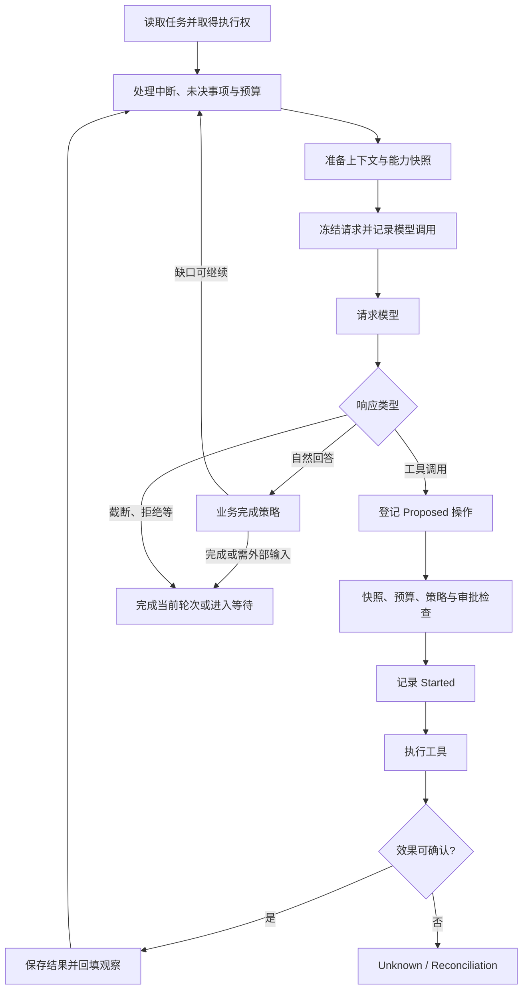

# V0：持久任务运行内核

[架构总览](architecture.md) · [V1 编码闭环](v1-coding.md) · [V2 长任务与进程](v2-processes.md) · [V3 上下文与恢复](v3-context-recovery.md) · [V4 可验收交付](v4-delivery.md)

设计范围：由 V0 建立、在 V1～V4 中持续复用的任务运行内核。

## 设计问题

一个模型调用可以产生文本或工具建议，却没有天然的任务寿命。HTTP 断开、模型返回完成文本、工具调用返回，都不足以说明用户目标已经完成。

V0 建立一个独立于协议和能力实现的执行内核：任务拥有身份、历史、预算和状态；模型是推进任务时使用的依赖；工具与外部资源通过显式契约接入。本文描述这一基础在当前体系中的职责，不要求后续版本永远不修改内核。

## 领域模型：为什么要分 Task、Turn、Step、Operation

| 对象 | 生命周期与责任 | 与相邻对象的区别 |
| --- | --- | --- |
| `AgentTaskState` | 持续目标、约束、授权、预算、完整历史及执行记录 | 可跨多个用户输入和等待阶段 |
| `TaskTurn` | 一次输入或继续处理形成的轮次 | 轮次完成后，任务可能继续等输入 |
| `TaskStep` | 一次模型调用的准备、能力快照和实际请求 | 将模型看见的内容固定下来 |
| `ToolOperation` | 一次工具建议的授权、执行和效果结算 | 模型提出调用不等于工具已经运行 |
| `ResourceReference` | 外部工作的身份、所有权与观测状态 | 生命周期可以超过创建它的工具操作 |
| `CommandReceipt` | 一个命令的持久接受与去重依据 | 等待请求返回不决定命令是否已经生效 |
| `EvidenceRecord` | 支撑业务完成的版本化事实 | 模型完成文本不能替代证据 |

这些层次分别回答“目标是什么”“这轮在做什么”“模型看到了什么”“实际执行了什么”“还有什么活着”。将它们合并成一份聊天消息列表，会使恢复、取消和审计失去独立依据。

## 命令与查询

任务控制以命令表达：Start 创建任务；Input 增加新轮次；Resume 继续未完成轮次；Approval、ExternalResult、Evidence 和 Reconcile 补充推进所需的事实；Pause、Cancel 控制任务寿命。资源和父子任务命令沿同一分发入口扩展。

命令携带稳定 ID 与载荷指纹。同 ID 同载荷返回已有收据或执行结果，同 ID 不同载荷构成冲突。持久接受先于返回后台提交的 202，因此调用方可以区分“尚未获知结果”和“命令没有被接受”。

Get/Observe 读取状态和事件。观察者的连接不拥有任务：关闭事件流不会隐式取消正在执行的任务。

## 调度与控制权

每个任务有两个主要协调点：Admission 处理命令身份与控制意图；Gate 串行化状态推进。执行时再取得存储 lease，防止多个执行器同时写同一任务。

Pause/Cancel 必须能够在 Gate 被模型或工具调用持有时发布中断意图；否则“取消”只会排在长调用之后。它们通过 Admission 校验后触发当前执行令牌，实际状态归档仍由执行内核完成。

HTTP 等待取消与任务取消分开。TaskApplicationService 根据宿主策略决定仅结束等待，还是显式提交 Cancel 并确认结果。原生后台提交只等待接受收据；收据返回后，任务由 Runtime 持有。

串行化限制了同任务吞吐，但使操作顺序、版本检查和收据更容易解释。需要长时间运行的外部工作使用资源协议，而不长期占住 Gate。

## 模型与工具的固定执行链

模型决定调用哪个工具、使用什么参数和如何解释观察。程序决定调用是否符合能力快照、是否需要审批、预算是否允许，以及结果如何写回。截断的工具参数不会进入真实执行。

调用方声明的函数工具与本地工具有不同所有权。本地工具由 Harness 执行；调用方工具返回给调用方并等待 ExternalResult。不能仅凭工具名把调用方的函数在服务器上执行。

## 状态与效果分离

`OperationStatus` 描述执行记录的阶段：Proposed、WaitingApproval、Started、Finished、Unknown。`EffectState` 描述外部效果：None、Confirmed、Partial、Unknown。

一个返回错误的调用可能已经修改文件；一个成功返回的查询也可能没有外部副作用。因此工具“成功/失败”和效果“是否发生”不能共用一个布尔值。

| 中断位置 | 能确认什么 | 继续原则 |
| --- | --- | --- |
| Started 未成功提交 | 没有获准开始实际执行 | 不执行工具 |
| Started 已保存，结果未知 | 可能已经发生副作用 | 标 Unknown，等待核实 |
| 确认无效果 | 原操作没有生效 | 经明确核实后可重新规划/执行 |
| 确认效果及结果 | 已执行且结果可归档 | 回填原结果，避免重复执行 |
| 模型请求中断、用量未保存 | 可能发生模型费用 | 保留未知用量，不擅自当作零消耗 |

Reconcile 表达可信核实后的决定，不能由模型的一句推测替代。没有跨资源事务的情况下，保守停止比自动重放更符合任务可解释性的目标。

## 能力快照与审批

每个 Step 记录工具定义、实现/配置版本、策略版本和工作区状态。审批绑定到具体 Operation 与快照，而不是“以后允许任意类似操作”。

执行之前如果工具、策略或工作区发生变化，原有未执行操作被明确关闭，模型需要基于新观察重新规划。旧审批不转移给新操作。V2 的纠正版本也加入这一机制，使用户改变方向后旧计划失效。

工具注册只是公开可选能力；真正执行时仍需策略与资源层校验。宿主配置和模型建议具有不同的信任级别。

## 上下文与预算

原始历史属于 TaskState，某次调用的 PreparedRequest 属于 Step。模型输入由历史、宿主指令、当前任务事实和工具定义构成。准备接口支持异步与取消，为后续投影算法留下边界。

容量限制与累计预算分别控制不同资源：

- 上下文容量限制单次发送内容，当前按实际 wire JSON 字符数检查，不是精确 tokenizer。
- 模型调用、工具调用和 token 用量限制整个任务的累计成本。
- 未知用量可以阻止继续，不能通过重建上下文消除已发生费用。
- 子任务先预留父任务可用预算，收集时按实际子用量结算一次。

历史保留使审计简单，但快照体积会增长。V0 提供容量检查与受控停止；[V3](v3-context-recovery.md)在同一请求准备阶段增加可选摘要与投影，保留真实状态、完整原文和累计预算。摘要关闭或无法安全压缩时仍沿用受控停止。

## 持久化与观察

FileTaskStore 以任务文件作为权威快照，lease 提供写入所有权，expectedRevision 防止覆盖不匹配版本。新快照先写临时文件、落盘，再原子替换。响应索引是可重建投影，不是任务唯一存储。

Task.Events 的单调序号用于观察与重连。事件保存在任务快照中，因此当前实现不是依赖事件重放重建全部状态的事件溯源系统。

这一方案适合单宿主与共享信任域，避免引入数据库和分布式事务；代价是大历史的写放大、文件系统语义约束，以及不提供任意多节点自动接管。

## 完成语义与父子任务

自然回答可以只完成当前轮次，任务继续等待输入；是否完成整个任务由完成策略决定。业务证据、未收集子任务和未收尾资源是不同门禁，不能相互替代。

[V4](v4-delivery.md)沿这个完成边界加入验收契约与交付事务。采用契约的任务，只有当前证据、产物和必要审阅满足，才能把交付引用与 TaskCompleted 同次提交；模型的自然回答仍只是候选。无契约任务保留原有策略，恢复也必须回到同一套门禁。

父任务创建子任务时保存稳定派发身份、受限事实和预算分配。收集结果前检查所有权、子任务状态与资源收尾；重复派发或收集由原命令/链接状态去重。它提供协作的基础契约，不等同于自动任务分解或多 Agent 调度器。

## 设计取舍与扩展约束

| 决策 | 理由 | 限制 |
| --- | --- | --- |
| 持久任务独立于 HTTP | 断连不应丢失真实工作 | 客户端需要区分提交、查询与取消 |
| 单内核、协议适配在外 | 减少不同协议间的控制漂移 | 协议只能表达支持的子集 |
| 显式 Unknown | 保留跨系统事务间隙的真实性 | 某些恢复需要外部核实 |
| 每步冻结能力与请求 | 为审批、重规划和追踪提供依据 | 记录占用空间，实现版本变化会使旧行动失效 |

新增能力应沿既有工具、资源、准备、完成策略和命令接口接入。修改内核时要维护这些不变量；不应把任务状态机搬到工具或某个 API 内。

## 源码导航

- [TaskModel](../../src/MiniHarness.Abstractions/TaskModel.cs)、[TaskContracts](../../src/MiniHarness.Abstractions/TaskContracts.cs)
- [TaskRuntime](../../src/MiniHarness.Harness/TaskRuntime.cs)、[工具操作](../../src/MiniHarness.Harness/TaskRuntime.Operations.cs)
- [应用服务](../../src/MiniHarness.Harness/TaskApplicationService.cs)、[文件存储](../../src/MiniHarness.Harness/FileTaskStore.cs)
- [上下文构建](../../src/MiniHarness.Harness/ContextBuilder.cs)、[父子任务](../../src/MiniHarness.Harness/TaskRuntime.Children.cs)
