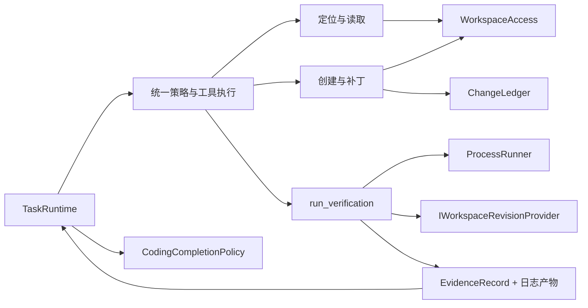
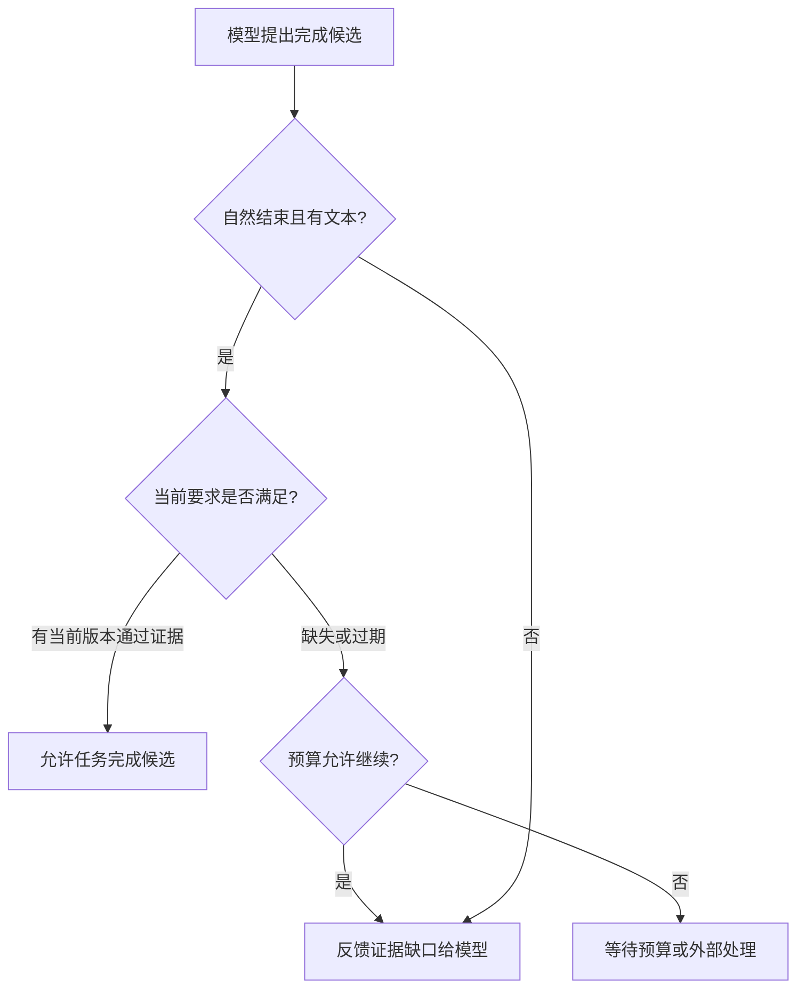

# V1：受控修改与版本化证据

[架构总览](architecture.md) · [V0 运行内核](v0-runtime.md) · [V2 长任务与进程](v2-processes.md)

设计范围：V0～V2 体系中的编码能力，基线 `1f363ee`。

## 设计问题

编码 Agent 的输出会改变用户文件。读取时看到的内容可能已经过期，运行测试可能修改工作区，模型声称“修复完成”也不证明测试确实执行过。

V1 将编码能力接入 V0 的工具与完成契约：允许模型自主选择定位、修改和验证步骤，但把工作区范围、编辑前置条件、实际变更与验证证据交给程序控制。

## 能力边界与模块关系

Coding 不直接控制下一次模型调用。它提供工具结果、证据和完成判断；Runtime 决定保存、继续、等待或停止。宿主通过 CodingComposition 统一注册工具、账本、验证 profile 和工作区指纹实现。

## 模型选择与程序约束

| 模型可以决定 | 程序必须保证 |
| --- | --- |
| 搜索什么、读取哪些片段 | 路径在工作区内、权限有效、输出有界 |
| 修改哪个文件、替换哪段内容 | 文件版本匹配、文本定位唯一、创建不覆盖 |
| 选哪个构建/测试 profile | 命令模板来自宿主，使用参数列表执行 |
| 如何根据失败输出继续修复 | 结果对应真实执行，未知效果不能自动重放 |
| 何时提出完成 | 当前任务要求的验证证据与当前工作区匹配 |

读、改、测是常见闭环，但顺序由模型按任务调整。失败输出是下一次决策的观察，而不是固定脚本的跳转指令。

## 工作区：一种授权范围

WorkspaceScope 包含根目录、版本指纹和 grants。根目录与授权来自宿主初始化，模型参数只选择范围内的路径。

WorkspaceAccess 集中处理路径规范化、越界检查、链接拒绝、读写授权以及大小/编码限制。各工具不自行发明路径判定。统一边界使读取、搜索与修改采用相同规则，也避免注册时检查一次后就长期信任路径。

返回内容受文件大小、行数、匹配数和输出长度限制。读取返回原始字节的哈希，作为后续编辑的版本前置条件；文本处理保留 BOM 和换行约定，减少与修改目标无关的差异。

这是一层应用级约束，不是操作系统沙箱。宿主允许执行的程序仍拥有宿主进程的系统权限，外部进程也可能同时改文件。设计面向受信任工程；路径检查与哈希检查不承诺抵御恶意并发文件系统置换。

## 编辑：显式前置条件优于猜测式重写

`create_file` 只创建不存在的文件。`apply_patch` 需要 expected_hash、old_text 和 new_text：实际文件哈希必须匹配，old_text 必须恰好出现一次。

哈希解决“我修改的是不是刚才读到的版本”；唯一匹配解决“修改位置是否明确”。它们让过期和歧义成为可纠正的观察，模型可重新读取并规划，而不是让程序猜测用户意图。

写入使用同目录临时文件与发布操作，随后确认盘面哈希并记录变更。没有多文件事务，也没有将文件修改与任务检查点纳入一个事务。独立记录这些阶段是必要的：

| 情况 | 工具效果语义 |
| --- | --- |
| 哈希过期、定位歧义、缺少权限，尚未修改 | 失败观察，Effect.None |
| 文件修改确认，账本写入成功 | Effect.Confirmed |
| 文件已修改，但账本未能保存 | Effect.Unknown，等待核实 |
| 发布结果无法确认 | Effect.Unknown，不能把原补丁自动再执行一次 |

固定流程不会用“返回异常”推断“没有发生修改”。这继承了 V0 对副作用和工具状态的区分。

## 变更账本：记录 Agent 行为的来源

ChangeLedger 关联 TaskId、OperationId、路径、修改前后内容或哈希。`get_changes` 以这些记录解释 Agent 所做的改动，而非将整个 Git 工作树的变化都归给当前任务。

账本记录与当前盘面可能因外部编辑而不同，报告必须保留这种差异。已确认写入后的记账失败不能通过重新应用补丁来修复；应核实文件和记录之间的关系。

账本的取舍是获得明确归属，同时承担额外持久化和故障窗口。它不会自动提交 Git，也不会对其他编辑者的工作作清理或回滚决定。

## 验证 profile：宿主定义执行能力

VerificationProfile 把 profile 名称映射到固定可执行程序、参数列表、时限、输出限制以及可选测试数量标记。模型只选择名称，不能在工具参数中替换 shell 命令或程序路径。

ProcessRunner 执行一次性命令，持续读取 stdout/stderr，区分正常退出、启动失败、超时与无法确认终止。等待命令结束和等待输出管道关闭都必须有界；父进程退出不总意味着子进程和输出句柄已经消失。

设计不把测试失败视为工具基础设施失败：执行完整但退出码非零，可产生一条失败验证证据供模型修正。只有无法确认执行效果或清理结果时，才需要进一步核实。

## 证据与工作区版本绑定

VerificationTool 在运行前后计算工作区指纹，并生成 EvidenceRecord。证据至少回答：哪个任务、哪个要求、哪个工作区版本、退出码是什么，以及日志产物在哪里。

通过条件包括：命令正常退出、退出码为 0、验证期间工作区指纹未变化。配置 TestCountRegex 时，还需匹配数量标记并达到 MinimumTests；未配置数量标记的 profile 不具备“确实发现测试数量”的额外证明，宿主应按验证类型选择。

指纹计算排除构建输出等指定目录，否则测试会因自身产物改变版本而使自己的证据失效。验证工具和 Runtime 的完成检查共用同一个 revision provider，避免一端认为版本相同、另一端认为不同。

**通过证据的有效性是版本相关的。** 修改代码后，旧通过记录仍是历史事实，但不能支撑新版本完成。指纹前后相等也不是文件系统隔离事务，不能证明过程中从未发生过随后又被还原的并发修改。

## 完成策略

CodingCompletionPolicy 对照 TaskFacts.RequiredEvidence，寻找当前任务、当前版本的通过记录。缺少证据或只有旧版本证据时，生成具体缺口反馈；预算允许则让模型继续，预算不足则等待。

上图描述配置了必需验证要求的任务。当前实现对没有 RequiredEvidence 的编码任务允许自然结束，因此“启用 Coding”本身不等于“已经配置测试门禁”。需要验证约束时，宿主必须声明 RequiredVerification。

CodingRoutingPolicy 根据任务是否具有验证要求或工作区执行授权选择编码策略，其他任务沿用普通完成策略。V2 进一步在 Runtime 叠加资源收尾检查，业务证据满足也不能使活进程变成无主资源。

## 与 V0 的一致性

V1 工具通过原 ToolRegistry、ToolExecutor 和 Operation 进入执行；它们使用 ToolExecutionContext 取得任务/步骤/操作身份与能力快照。工作区变化后的失效处理、审批、预算、结果未知时的核实都仍由原内核实施。

修改文件会改变工作区版本，因此同批后续操作可能被旧快照失效规则关闭。模型需要读取新观察后重规划；这避免将针对旧版本的审批或操作静默应用到新版本。

## 设计取舍与范围

| 选择 | 设计收益 | 边界 |
| --- | --- | --- |
| 哈希 + 唯一文本替换 | 修改意图简单、冲突可解释 | 不是语义重构引擎，不提供多文件原子变更 |
| 宿主 profile | 可执行范围与模型选择分离 | 新命令需要宿主配置，不是任意终端 |
| 当前版本证据 | 防止以旧测试结果宣告新代码完成 | 验证质量仍依赖 profile 和测试本身 |
| 单独变更账本 | 能解释本任务操作归属 | 不提供跨文件/检查点的统一事务 |

当前工具覆盖有界定位与读取、文件创建、唯一匹配补丁、变更查询和一次性验证。语义检索、复杂重命名、自动提交/PR 等不是这层设计的隐含能力。

## 源码导航

- [工作区访问](../../src/MiniHarness.Coding/WorkspaceAccess.cs)、[定位工具](../../src/MiniHarness.Coding/LocationTools.cs)
- [修改工具](../../src/MiniHarness.Coding/MutationTools.cs)、[变更账本](../../src/MiniHarness.Coding/ChangeLedger.cs)
- [验证工具](../../src/MiniHarness.Coding/VerificationTool.cs)、[一次性进程执行](../../src/MiniHarness.Coding/ProcessRunner.cs)
- [编码完成策略](../../src/MiniHarness.Coding/CodingCompletionPolicy.cs)、[策略路由](../../src/MiniHarness.Coding/CodingRoutingPolicy.cs)
- [宿主组装与 profile](../../src/MiniHarness.Server/CodingServerOptions.cs)
