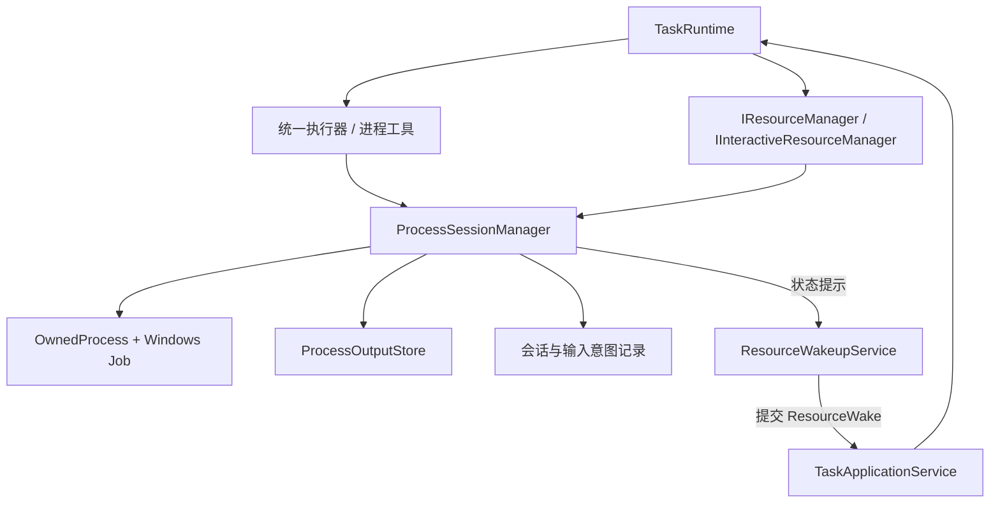
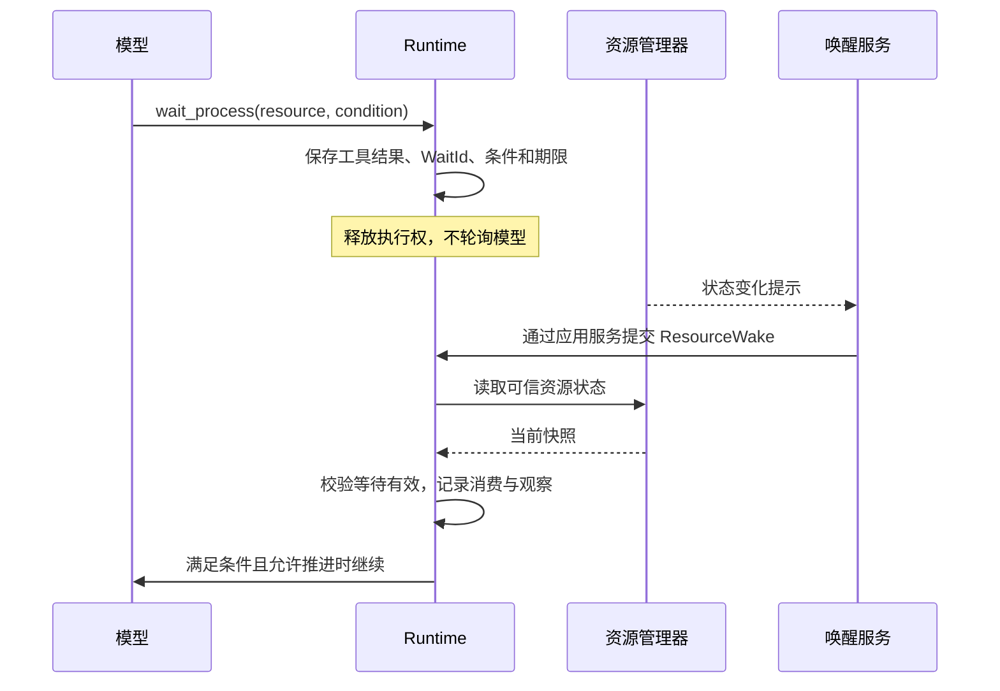

# V2：长任务、资源生命周期与中途控制

[架构总览](architecture.md) · [V0 运行内核](v0-runtime.md) · [V1 编码闭环](v1-coding.md)

设计范围：V2 的资源与长任务机制，基线 `1f363ee`。

## 设计问题

编译可以等待退出，开发服务、交互式 worker 或长期观察则可能持续运行。如果工具调用一直占住任务执行权，用户的纠正和后续动作就只能排队等待；若简单丢进后台，又会失去句柄所有权、输出和取消依据。

V2 将长时间工作表示为资源：启动调用可以结束，进程继续存活；任务通过稳定资源 ID 观察与控制它。等待是持久状态，状态变化通过命令重新进入同一个 Runtime。

## 三种生命周期

| 生命周期 | 所有者 | 结束意味着什么 |
| --- | --- | --- |
| HTTP 请求/观察连接 | Server 与应用服务 | 调用方结束等待或观察 |
| Task/Turn/Operation | TaskRuntime | 目标、轮次或一次工具请求结束 |
| 进程会话与 OS 资源 | ProcessSessionManager | 进程树、管道和句柄已被确认处理 |

一个启动 Operation 可以是 Finished，而 Resource 仍为 running。一次普通轮次可以回答“服务已启动”，但资源继续属于任务。Task Cancelled 也只表明不再推进，资源是否确认收尾需要单独检查。

## 组件与所有权

会话管理器负责 OS 句柄、输入输出和真实生命周期；Runtime 负责把可信资源观察写入任务状态。管理器回调不能直接追加模型历史，唤醒服务不能自行调用模型。

模型工具与原生命令共用同一个会话管理器。创建资源使用 ToolOutcome.Resources；更新已有资源使用 ResourceUpdates，更新不能改变 Kind、OwnerTaskId 或创建操作所有权。读取输出的操作不会成为资源的新主人。

## 启动协议：先建立所有权，再放行程序

进程身份由 TaskId 与创建操作 ID 稳定派生，启动重试可以找到原记录。会话目录另有宿主所有权锁；无法取得锁的管理器只能保守读取/对账，不能在同一目录开始新会话。

启动遵循以下顺序：

1. 检查工作区授权、profile、并发配额和寿命限制。
2. 保存稳定会话 ID、冻结 profile 和启动意图。
3. 在 Windows 上挂起创建进程，限制继承句柄，先绑定 Job。
4. 建立输出读取与输入句柄，保存会话状态，再放行进程。
5. 将资源引用返回 Runtime，由原 Operation 流程归档。

挂起创建用于关闭“程序已经派生子进程，但所有权尚未建立”的窗口。Job 负责拥有进程树，即使启动父进程先退出，也能查询或终止仍属于 Job 的子进程。

这项选择使后台进程能力当前限定于 Windows。不能建立树所有权时，不将启动视为正常运行。启动超时后才返回的句柄也必须回收，不放行已经超时的用户程序。

## 资源状态与失败窗口

正常路径为 starting → running → finished。取消先记录 cancellation_requested，再执行终止并确认；寿命或输出故障可以产生 failed。无法核实启动/退出时保留 unknown。

字符串终态与 TerminationConfirmed 一起表达是否已确认收尾。finished 说明生命周期结束，不表示退出码为 0，更不自动产生 V1 验证通过证据。

| 情况 | 设计处理 |
| --- | --- |
| 启动意图保存失败 | 不创建 OS 进程 |
| 意图已保存、是否创建未知 | 保留未知，不依据重试再次启动 |
| 进程已启动、任务结果尚未提交 | 根据稳定身份查管理器记录，核实原执行 |
| 取消请求已记录、终止未确认 | 保留未确认状态，允许继续 Query/Reconcile/Cancel |
| 宿主重启，旧非终态记录还在 | 视为需要核实；不凭旧 PID 接管、重启或杀进程 |

PID 可能被复用，是诊断字段而非持久身份。Job 回收 OS 进程，也不能证明该进程此前没有修改文件。

## 持续输出：有界数据面

stdout 和 stderr 分别持续排空，按 Harness 接收顺序形成带 stream 的序号块。序号保证本存储的顺序，不声称还原两个 OS 管道的精确发生顺序。

输出读取使用独立消费者游标。相同 after 可以重读，没有一个被客户端或模型共同推进的全局消费指针。旧块因容量限制淘汰后，用 FirstAvailableSequence、Gap 和 Truncated 明确表达缺口。

内存、磁盘和返回页面分别有界，字节限制考虑 UTF-8 和返回 JSON 开销。持续日志不逐块加入 Task.History 或 Task.Events，避免输出速度直接放大检查点和模型上下文。任务事件只提供有界的“输出可读取”提示，正文通过输出接口读取。

Task.Events 的事件游标与进程输出游标是不同序列。重连进度流不能替代输出消费位置。输出文件在结束封存后才注册固定哈希的 Artifact，运行中的可变日志不冒充不可变产物。

日志发布失败会明确降级并触发停止；输出线程仍需避免堵住管道。设计承认截断或日志不可用，不能以静默丢失换取表面成功。

## stdin：有副作用的交互操作

stdin 由 profile 显式允许。每次请求需要资源身份、会话代次、稳定动作 ID，以及受限文本或关闭输入动作。写入串行化，排队、写入和刷新共享有界期限。

输入意图先保存，字节写入后再记录完成。相同动作 ID 的已确认写入不重发，不同载荷冲突。写入发生后记录失败则结果未知，需要核实；普通 stdin 不提供应用级应答事务，不能承诺跨崩溃 exactly-once。

原生 WriteResourceInput 也经 Runtime 保存意图，再调用同一个管理器；HTTP 不直接调用 Stream.Write。进程输入回执作为外部观察，不伪造模型没有提出过的 tool_call。

## 等待：保存条件并释放执行权

wait_process 返回结构化 WaitRequest，而不是在工具方法中等到进程退出。Runtime 在本批工具结果合法结算后保存 ResourceWait，进入等待并释放 Gate/lease。

通知是提示，周期性检查提供兜底，覆盖通知丢失或资源先结束、等待后登记的情况。内核重新检查真实状态，不能信任请求自称“进程已退出”。

WaitId 关联轮次和等待条件；已消费、已失效或旧轮次的通知不推进任务。Exit、Output 和等待截止有不同语义：等待超时回填观察，不自动终止进程。暂停时可以更新观察，但不自动调用模型；取消后不重新推进。

完成门禁也可能登记资源等待。资源确已结束时可以复核已有完成候选；若只是等待超时，则交还模型新的决策机会，不能无界续等一个旧完成候选。

## 用户纠正、暂停与取消

| 动作 | 对 Agent 的作用 | 对进程的作用 |
| --- | --- | --- |
| `Input` | 在上一轮完成后开始新轮次 | 不隐式改变已有资源 |
| `Steer` | 在当前轮次追加纠正，关闭尚未执行的旧行动 | 不自动杀死所有进程 |
| `WriteResourceInput` | 记录外部交互观察 | 向获准会话写 stdin 或 EOF |
| `Pause` | 中断或暂停推进，等待显式继续 | 不等于挂起 OS 进程 |
| `CancelResource` | 更新资源状态 | 终止并确认指定进程树 |
| `Cancel` | 停止任务继续并传播取消 | 尝试回收所属活资源，保留未确认结果 |

Steer 先校验 payload 再发布安全点标记。模型调用或短工具结束时，Runtime 停止启动后续旧行动，为未开始操作补齐明确拒绝结果，再保存新输入并重规划。Started/Unknown 不能当作未发生处理；存在未配对的操作时，新观察可暂存，避免破坏工具调用与结果关系。

这种方式保留同一任务与预算，也避免制造两条同时推进的执行链。代价是 Steer 不能保证即时抢占正在进行的模型请求，其延迟受当前调用期限约束。

HTTP 同步等待的断开/超时遵守统一 CancelOnDisconnect 策略。wait=false 的 202 只表示持久接受；已返回后的任务独立运行。只读 GET 或 SSE 观察断开不取消进程。

## 完成、停机与恢复边界

业务完成策略允许 TaskCompleted 后，Runtime 还检查资源与子任务。进程仍活着或退出未知会阻止完整任务完成；普通轮次回答可以先结束，资源仍由原任务持有，没有隐式 detach。

停机先停止新推进和自动唤醒，再暂停/排空任务执行，清理会话并对账；不能只依赖对象 Dispose 的偶然顺序。进程树回收、输入输出排空和句柄释放都应具有期限与确认结果。

当前检查点可以支撑有限继续，旧宿主的活句柄却不能直接恢复。更完整的重启分类、自动摘要和任务恢复调度需要在同一内核内继续扩展；V2 不将未知状态包装成无缝恢复。

## 与 V0/V1 的关系与设计取舍

| 决策 | 保留的基础 | 新增代价 |
| --- | --- | --- |
| 长工作表示为 Resource | 原资源契约和操作所有权 | 需要独立会话、日志与对账 |
| 等待经命令唤醒 | 原收据、状态机和预算 | 需要去重与处理事件竞态 |
| 进程工具与原生命令共用管理器 | 同一实际执行能力 | 两类触发的授权与回执语义要明确 |
| 资源收尾加入完成门禁 | 原证据完成流程 | 已满足业务证据的任务也可能继续等待清理 |

V1 的 run_verification 继续承担同步验证和证据生成；V2 的 start_process 负责资源化执行。它们解决不同生命周期问题，共享任务控制规则，没有为长进程重新建立 Agent 循环。

## 源码导航

- [资源契约](../../src/MiniHarness.Abstractions/ResourceContracts.cs)、[运行时资源管理](../../src/MiniHarness.Harness/TaskRuntime.Resources.cs)
- [等待与纠正](../../src/MiniHarness.Harness/TaskRuntime.Waiting.cs)、[完成门禁](../../src/MiniHarness.Harness/TaskRuntime.Completion.cs)
- [进程工具](../../src/MiniHarness.Coding/Processes/ProcessTools.cs)、[会话管理器](../../src/MiniHarness.Coding/Processes/ProcessSessionManager.cs)
- [受管进程创建](../../src/MiniHarness.Coding/Processes/OwnedProcess.cs)、[输出存储](../../src/MiniHarness.Coding/Processes/ProcessOutputStore.cs)
- [宿主唤醒服务](../../src/MiniHarness.Server/ResourceWakeupService.cs)
