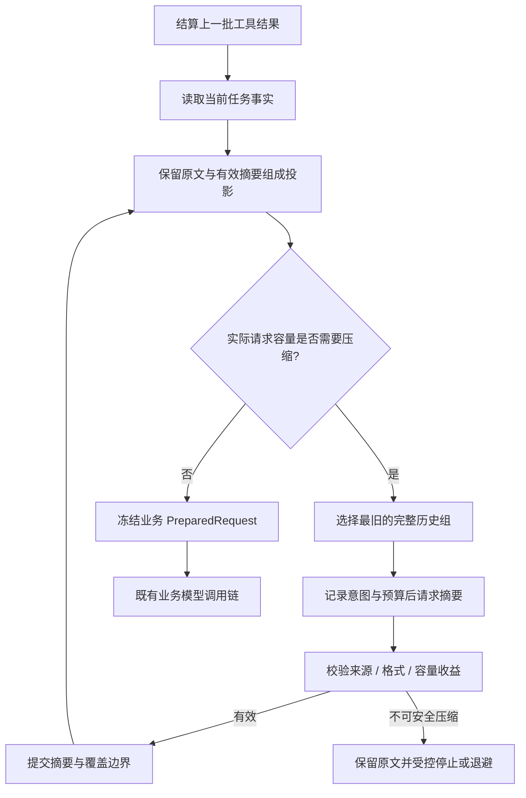

# V3：上下文与恢复

[项目入口](../../README.md) · [架构总览](architecture.md) · [V2 长任务与进程](v2-processes.md) · [V4 可验收交付](v4-delivery.md)

设计范围：在同一 TaskRuntime 中重建有界模型输入，并在宿主中断后按照已保存事实受控继续。

## 设计问题

长任务面临两种连续性问题：模型容不下不断增长的历史，宿主重启后也不能直接从内存中的下一行继续。两者都要求区分真实执行状态与模型看到的描述。

V3 保留任务身份、约束、成本和执行事实，用投影解决模型输入容量，用恢复分类决定下一步是否合法。它不把摘要当作任务数据库，也不把重启等同于重新运行。

## 三种数据，不同权威

| 数据 | 职责 | 能否决定权限与完成 |
| --- | --- | --- |
| 任务事实与执行记录 | 保存授权、预算、操作、资源、证据及控制状态 | 可以，是程序裁决的依据 |
| 原始历史 | 保留用户、模型、工具和外部观察的原文及关联 | 可供追溯，文本自述不能替代真实记录 |
| 模型输入投影 | 组合当前事实、受校验摘要和近期完整交互 | 不可以，只是某次推理的输入 |

例如，摘要写“测试通过”不能新增验证证据，写“进程已结束”不能解除未知资源。当前事实由 Runtime 重新注入，即使历史摘要过期，也不能把旧权限带回执行链。

## 上下文在请求冻结之前准备

ConversationSegmenter 将一次模型工具调用和对应结果作为完整交互组。未闭合组不能进入摘要；组内任一消息需要固定保留时，整组保留，避免剩下一条失去调用来源的工具结果。

ContextPlanner 从最旧、已闭合的前缀选择覆盖边界，保留近期完整组。有效指令、用户纠正和不能安全压缩的供应商原生内容独立保留。投影可使用摘要替换部分描述，但不修改原历史。

容量检查针对实际发送的 wire JSON 字符数，包含模型输入和工具定义；它不是精确 token 计数。固定事实或不可拆交互本身超过上限时，删去要求来容纳请求会改变任务含义，因此应停止并报告原因。

## 摘要是候选，程序决定是否采用

ISummaryGenerator 负责生成结构化描述，内容包括背景、已尝试事项、待办、路径与历史引用。它不执行工具，不批准行动，不判断任务完成。

Runtime 在发起摘要请求前保存调用意图、来源边界、来源哈希、模板版本和模型绑定。返回后校验完整自然结束、结构与长度、引用是否来自指定历史，以及原始覆盖范围是否仍匹配。已有摘要可以作为下一次摘要的输入，但父子摘要关系和来源绑定仍须有效。

格式正确不足以让摘要生效。Runtime 还检查实际输入缩减是否达到配置要求，受单次推进和任务累计摘要调用上限约束；失败有退避，不能为了压缩无限调用模型。摘要输入同样有容量上限，大历史按可容纳的完整前缀逐次处理。

供应商加密 reasoning 等不透明内容不参与语义摘要。需要保留的原生尾部按原顺序传递，是否能压缩由 continuation policy 决定；不能从加密数据推测其含义，也不承诺跨供应商迁移这些原生项。

## 业务推理与摘要共用成本账本

ModelInvocationRecord 通过 Purpose 区分 Reasoning 与 Summary，但两者使用同一任务预算。Started 表示调用意图已记录，Responded 表示响应已保存；UsageApplied 与 ResultApplied 分别防止重复计费和重复应用结果。

| 中断或失败 | 成本与结果规则 |
| --- | --- |
| 摘要格式错误、引用无效或没有压缩收益 | 不采用摘要，已经发生的费用仍保留 |
| 请求可能已发送，响应和用量未保存 | 保留 Unknown，不按零费用自动重试 |
| 响应已保存，业务结果尚未应用 | 在允许的安全点应用已存结果，不再请求同一响应 |
| 获授权的费用核对 | 更新真实用量，不伪造曾收到模型响应 |
| 子任务后补用量 | 按差额汇总到父任务，不能重复结算 |

预算决定能否启动新工作。对已付费且结果已保存的本地结算，应与新增模型调用区别处理；未知费用仍须先核实，不能借恢复消除。

## 恢复先分类，再继续

Recover 读取迁移后的状态，核对当前模型与宿主授权，规范化中断记录并保存恢复报告。它不执行业务模型或工具。Resume 在允许的恢复点进入已有推进链；扫描器负责发现任务和提交命令，不直接调用模型。

| 持久事实 | 恢复处理原则 |
| --- | --- |
| 准备中断，尚无已发送调用 | 重建准备条件，重新核对快照和预算 |
| 模型响应已保存但尚未应用 | 结算保存的响应，避免重复请求 |
| 模型调用或用量未知 | 核对真实费用和结果，不免费重试 |
| 工具 Started、效果未知 | 保留或转为 Unknown，等待可信核实 |
| 等待审批、外部结果、资源或子任务 | 保留对应等待，不假定条件已经满足 |
| 暂停或终态 | 不自动推进，不以重启重置用户决定 |
| 模型绑定或宿主授权变化 | 阻止继续，不能静默套用新配置 |

Manual 是默认模式，只分类。Safe 是显式开启的有限自动继续，仍受存储 lease、恢复令牌、并发、次数、权限和累计预算约束。令牌用于防止重复调度同一个恢复机会，不能替代重新检查当前事实。

重启不会恢复 OS 句柄。旧进程意图能提供归属线索，但不能凭旧 PID 接管、杀死或重启。确认进程消失，与确认它没有产生文件副作用，是两件事；这延续了 V2 的资源核实边界。

## 查询、历史分支与格式演进

只读接口分别提供上下文诊断、恢复状态、原历史分页和后台失败信息。查询本身不执行 Recover、不写任务、不调用模型；需要持久化分类或继续时使用命令。示例见[上下文与恢复请求](../../examples/context-recovery.http)。

Responses 的历史分支从指定响应的原文边界创建新任务，不复用该边界之后的摘要、约束、资源或预算。原任务与新分支拥有不同身份，不能把“带历史输入”解释为“恢复同一任务”。

检查点迁移在读取时形成可用内存状态，首次写入前保留旧格式备份。V3 引入的格式由 V4 继续演进到 schema 3；旧任务可以读取和继续，不意味着旧二进制能理解新状态，也不能为旧任务伪造后来才定义的交付事实。

## V4 如何使用恢复与上下文边界

V4 的验收缺口来自确定性评估器，并作为当前事实进入上下文。摘要不能修改 AcceptanceSpec、Review 决定或 NoProgress 计数，也不能把历史成功提升为当前有效证据。

Review 和 NoProgress 在重启后仍需要相应授权。已经形成的合格候选可以进入本地核对与封存，不需要重新调用模型、修改文件或运行验证；未知费用、未知副作用、暂停和取消仍然限制该过程。具体断点见[V4 交付设计](v4-delivery.md)。

## 设计取舍

| 选择 | 收益 | 边界 |
| --- | --- | --- |
| 保留原历史，只压缩发送视图 | 审计、历史分支与故障定位可追溯 | 检查点体积仍随历史增长 |
| 按完整交互分组 | 保持工具调用与结果配对 | 大型不可拆组可能直接超限 |
| 程序校验摘要，统一记录费用 | 不让模型记忆取得控制权 | 摘要仍可能遗漏语义，重要约束必须保存在事实中 |
| 恢复分类与继续分开 | 读取和诊断不会隐式执行工作 | 某些状态需要明确人工或宿主核实 |
| 有限自动恢复 | 减少安全断点后的人工操作 | 不提供任意状态续跑或跨宿主进程接管 |

## 源码导航

- [上下文契约](../../src/MiniHarness.Abstractions/ContextContracts.cs)、[恢复契约](../../src/MiniHarness.Abstractions/RecoveryContracts.cs)
- [分组、投影与摘要校验](../../src/MiniHarness.Harness/Context/ContextPlanning.cs)、[上下文编排](../../src/MiniHarness.Harness/TaskRuntime.Context.cs)
- [统一模型调用账本](../../src/MiniHarness.Harness/TaskRuntime.ModelCalls.cs)、[恢复分类与核实](../../src/MiniHarness.Harness/TaskRuntime.Recovery.cs)
- [格式迁移](../../src/MiniHarness.Harness/TaskStateMigration.cs)、[任务存储](../../src/MiniHarness.Harness/FileTaskStore.cs)
- [宿主恢复扫描](../../src/MiniHarness.Server/TaskRecoveryService.cs)、[宿主恢复授权](../../src/MiniHarness.Server/HostRecoveryAuthorizer.cs)
