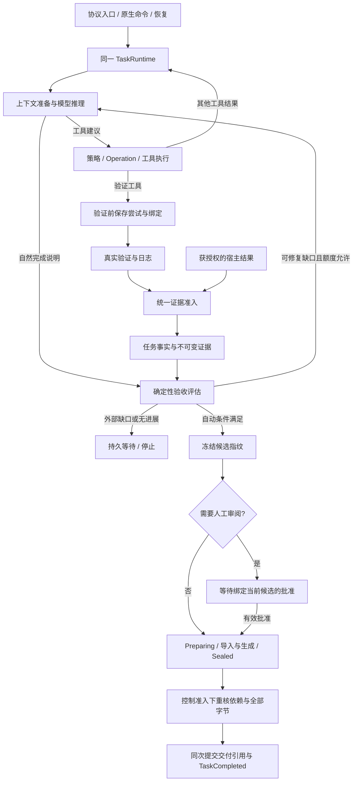

# V4：可验收的本地交付

[项目入口](../../README.md) · [架构总览](architecture.md) · [V1 编码闭环](v1-coding.md) · [V2 长任务与进程](v2-processes.md) · [V3 上下文与恢复](v3-context-recovery.md)

每个采用 AcceptanceSpec 的任务，进入 TaskCompleted 时必须原子关联一份已封存、可独立核查的交付记录。没有契约的旧任务保留原完成语义，不补造记录。普通轮次完成不等于交付完成。

## 设计问题

V1 已能把代码修改和验证结果关联起来，V2 管理仍在运行的资源，V3 保留长任务的上下文与恢复事实。但“曾经测试通过”仍不足以解释最终交付：要求可能变化，后续验证可能失败，产物可能被替换，人工批准也可能针对旧版本。

V4 将完成定义为一个可复核的事实组合：当前要求、当前验证对象、可信执行结果、冻结产物以及必要的审阅必须一致。缺口能由模型修复时反馈给模型；需要外部证据时等待；重复无效修复时停止。存储失败则进入本地处理，不能让模型为磁盘故障反复改代码。

## 在既有执行链中的位置



图中的验收与封存都是 Runtime 的固定阶段。模型与宿主可以提出动作，但不能自行修改阶段结果。恢复、自动完成和审阅后的本地结算共享同一条封存路径。

## 职责与信任范围

三个入口仍汇聚到同一应用服务和 TaskRuntime。Runtime 管状态、准入、预算、安全点与提交；AcceptanceEvaluator 只根据事实判定；ArtifactStore 只处理受控文件；Coding 提供真实验证器和变更账本适配。没有新模型循环，也没有按协议分支的交付器。

固定支持 VerificationProfile、ArtifactPresence、HumanReview。模型能选择工具和提出完成说明，不能修改契约、批准自己、指定可信来源或绕过停止条件。

| 组件 | 设计责任 |
| --- | --- |
| AcceptanceSpec 与宿主授权 | 定义要求、保护范围、版本与不可降低的宿主下限 |
| TaskRuntime | 持有任务状态，编排尝试、证据、候选、审阅与最终提交 |
| EvidenceAdmission | 校验执行绑定、来源和唯一结算，统一工具与宿主结果准入 |
| AcceptanceEvaluator / ProgressPolicy | 从持久事实确定缺口、候选资格与无进展状态 |
| IChangeSetProvider | 采集工作区基线、冻结变更集，核对账本与盘面，区分 Agent 修改和外部变化 |
| IArtifactStore / DeliveryManifestBuilder | 保存及读取冻结内容，构建清单并支持独立复验 |

硬编码的是准入顺序与不变量：先记录尝试再执行、按代次选证据、先满足自动检查再审阅、最终核验后原子提交。模型动态决定的是修复方案、工具选择和完成说明。二者通过结构化工具结果、验收缺口和任务命令串联，程序不预先写死每项业务的读改测步骤。

部署面向单宿主共享信任域。宿主显式开启外部证据、审阅、修订、产物导入或人工继续，代表信任能访问这些管理命令的调用方；Actor 由宿主配置，客户端字符串不构成身份认证。首版无远程签名、多租户身份、任意规则 DSL、自动发布或 OS 文件隔离。

## 契约、绑定与内容身份

| 标识 | 解决的问题 |
| --- | --- |
| SpecHash / CriterionId | 当前按哪一版要求、哪一条标准判定 |
| AttemptId / Generation | 哪一次验证执行，以及执行顺序 |
| WorkspaceRevision / SubjectHash | 验证面对的是哪份工作区或逻辑产物 |
| VerifierFingerprint | 执行器是否仍是被冻结的 profile 配置 |
| CandidateFingerprint | 审阅和封存是否针对同一组事实与说明 |
| ArtifactId + TaskId | 谁拥有这份产物引用 |
| BlobHash / manifest 哈希 | 实际内容是否与冻结记录一致 |

这些标识不能相互替代。两个任务可以拥有相同内容哈希，却没有彼此的访问权；同一工作区可重复验证，却必须区分新失败与旧成功；任务修订号可因记账变化，而无需让同一候选的批准失效。

## 状态与命令契约

所有命令先去重。同 ID 同载荷返回原收据；同 ID 不同载荷冲突。新的命令 ID 不代表新的验证尝试、批准或人工继续额度。旧命令的指纹分支保持；V4 命令使用独立版本分支。

下表合并展示任务状态与等待原因，并非新增一套状态枚举。允许的动作仍须满足宿主权限、模型绑定、任务归属和其他阻塞。运行中的命令在同一 Gate/lease 中执行；Pause/Cancel/Steer 的准入独立于长执行锁。

| 状态 | AmendAcceptanceSpec | ReviewDelivery | ContinueAfterNoProgress | FinalizeDelivery |
| --- | --- | --- | --- | --- |
| Ready/Running | 安全点检查预期 SpecHash、递增版本及宿主下限 | 仅当前候选有效，重核依赖 | 无有效停止指纹则冲突 | 有完成回答时本地评估，未满足不得封存 |
| Evidence/Budget | 同上，旧候选失效 | 不能替代未通过的自动检查 | 只在 NoProgress 标识仍生效时允许 | 合格候选可本地结算；不能新增模型额度 |
| Review | 修订使候选和批准失效 | 同候选同决定幂等，矛盾决定冲突；过期依赖拒绝并失效候选 | 无停止状态则冲突 | 未获有效批准保持等待 |
| NoProgress | 不清空历史计数和成本 | 只能解除 Review，不授予模型尝试 | 必须匹配停止指纹、理由和有限授权额度 | 补齐事实后可本地完成；否则保持停止 |
| Reconciliation/Infrastructure | 授权修订不能洗掉未知事实 | 不解除核实或基础设施门禁 | 不解除其他阻塞 | 只能重新核实与本地结算，不能假定成功 |
| Paused | 可以保存授权事实，不自动启动模型 | 保存有效决定，不自动推进 | 保存有限额度，仍需显式 Resume | 保持暂停，不自动封存 |
| Completed | 拒绝修订，后续要求建立新任务 | 当前已提交候选的重复接受可返回结果，其他冲突 | 拒绝 | 仅匹配已提交候选时返回结果 |
| Cancelled/Failed | 拒绝 | 拒绝 | 拒绝 | 拒绝 |

BeginVerification、SubmitVerification、ReconcileVerification 和 RegisterDeliveryArtifact 默认禁止外部调用，须由宿主显式授权。旧 Evidence 命令不能为 V4 任务注入可信记录。Begin 只建立持久尝试，不代表运行命令；实际外部生产者由获信任的宿主负责。工具返回与外部结果共用 EvidenceAdmission。

## 多重阻塞的操作准入

保存全部 Blockers；主要 WaitReason 用于展示，不能解除其他限制。查询不改变任务、不增加模型调用或进展采样。

| 限制 | 查询 | 接收获授权事实/本地评估 | 新模型行动 | 工具执行 | 最终封存 |
| --- | --- | --- | --- | --- | --- |
| Review | 允许 | 允许，批准绑定候选 | 普通 Resume 禁止；明确拒绝或纠正才进入修复 | 不因批准获得工具授权 | 有效批准及其他条件全部满足才允许 |
| NoProgress | 允许 | 允许 | 显式有限继续且累计预算足够 | 仍受进展、审批和工具预算限制 | 合格候选允许，无需额外模型额度 |
| 已知模型调用/token 预算耗尽 | 允许 | 允许 | 禁止 | token、工具次数等限制分别生效 | 在产物容量和 I/O 时限内允许 |
| 未知费用/副作用/验证 | 允许 | 允许明确核实 | 禁止绕过 | 不重放未知操作 | 禁止 |
| 保护文件变化/证据过期 | 允许 | 允许 | 仅可修复的缺口允许继续 | 不能修改冻结原件来降低要求 | 禁止 |
| 基础设施错误 | 允许可读部分 | 显式重试本地处理 | 不当成代码修复反馈 | 不重复已有副作用 | 故障解决并重校验后允许 |
| Paused | 允许 | 可保存事实 | 禁止 | 禁止自动执行 | 显式恢复后才推进 |

## 证据尝试与唯一结算

绑定由 TaskId、CriterionId、SpecHash、WorkspaceRevision、产物 SubjectHash 和 VerifierFingerprint 组成。执行开始前持久化 AttemptId、代次和 Pending。重复同尝试不产生新代次；同绑定最多一个 Pending/Unknown 尝试。

| 原状态 | 观察 | 结果 |
| --- | --- | --- |
| Pending | 已确认结束的成功/失败/取消 | 唯一最终结果 |
| Pending | 无法确认结束、进程/结果未知 | Unknown，保留在途限制 |
| Unknown | 普通迟到结果 | 拒绝直接覆盖，保留冲突诊断 |
| Unknown | 获授权 ReconcileVerification | 核实后结算原尝试，不另开代次 |
| 已结算 | 同一内容重复提交 | 幂等，不增加接收序号 |
| 已结算 | 不同 EvidenceId 或矛盾最终内容 | 冲突，不能形成第二个有效结果 |

选择当前绑定的最大执行代次，不按返回时间决定新旧。最新失败、取消、Pending 或 Unknown 都不能回退采用旧成功。接收序号仅审计。profile 使用实际结构化内容指纹；日志复制后按实际字节核验。未受信任的旧记录只保留历史。

## 文件保护与变更归属

任务开始时冻结 ProtectionBaseline，封存前只读取与检查，绝不刷新为新基线。修改工具执行前检查目标；验证及封存时再次检查实际文件。允许新增回归测试的范围不允许覆盖基线中已有文件。保护范围首版不支持任务中调整。

显式保护范围单独遍历全部后代，不使用普通盘面清单对 bin、obj、.git、.data 的忽略规则；重叠范围去重，链接拒绝，遍历支持取消并限制为 65536 个不同路径。空目录也会在后续核对时检查新增文件。

变更集区分 Agent 账本记录与未被 Agent 触碰的外部文件变化。Agent 记录与盘面、首次基线冲突时停止封存；不能把混合编辑冒充 Agent 成果。外部输入的可分离变化单列 ExternalEntries。补丁带基线/前后哈希，不保证适用于任意工作区。

初始清单与完成时盘面清单由同一 IChangeSetProvider 生成，采用相同忽略目录规则；新出现的未登记文件也会单列，混合编辑在下一次修改前拦截。清单采集上限为 4096 个文件、单文件 8 MiB、总计 64 MiB。

应用级检查能够检测声明范围内的变化，不能阻止外部进程写文件，也不证明两次哈希之间每个字节始终不变。

## 候选、审阅与封存

候选指纹绑定要求、工作区、SteeringRevision、验证尝试及不可变结果、产物、保护基线、变更集和被审阅的说明。查询、时间、Task.Revision、摘要费用不进入候选指纹。

先完成自动检查，再建立可审阅候选。人工批准反向绑定指纹，不进入候选哈希，避免循环依赖。拒绝意见进入权威历史并使候选失效；新的模型行动仍需预算和进展额度。

同一完成方法被模型自然结束、人工批准和恢复后的 FinalizeDelivery 共用：

1. 核对当前工作区、保护基线、验收和变更归属。
2. 保留资源、子任务、未知副作用与费用门禁。
3. 保存候选；必要时释放执行权等待 Review。
4. 保存 Preparing 和冻结时间、成本。
5. 导入不可变内容，确定性生成 changes.json、delivery.md 和 manifest。
6. 保存 Sealed，再核对依赖和文件。
7. 持有与控制准入共用的 Admission 锁，检查已准入控制，按哈希与长度重新读取 manifest 及其中全部产物（包括生成的 changes.json 和 delivery.md），通过后在同一次 TaskStore 提交中保存 Committed、manifest 引用及 TaskCompleted。损坏或缺失进入 Infrastructure 等待，不报告完成。

Admission 锁只包围最终本地提交，不包围模型或工具长执行。控制先获准则阻止完成；完成先持久提交则晚到控制不得改写历史。文件中已有 manifest 不代表 TaskCompleted。

NoProgress 是新增模型工作的独立准入条件，自动检查通过或人工拒绝均不能解除它。有限继续额度在业务 Step 结算时消耗，耗尽后仍可接受审阅并本地完成，但再次拒绝不能产生未获授权的新调用。

## 持久化断点与恢复

| 断点 | 恢复动作 |
| --- | --- |
| 验证 Pending，操作未确认结束 | 转 Unknown，禁止盲目重跑 |
| 业务 Step 与进展已提交 | 按稳定 Step ID 跳过重复计数 |
| 候选已保存 | 重新核对当前依赖，继续或失效 |
| Preparing/部分 blob 已写 | 重用已校验内容，确定性重建剩余部分 |
| Sealed，最终提交未成功 | 重校验与提交引用，不重跑验证、修改或模型 |
| Committed | 保留完成；重复同候选命令不产生新交付 |
| Review/NoProgress | 保留候选、决定、计数和停止指纹；Manual/Safe 均不能代替批准或继续授权 |
| 宿主验收策略变化 | 报告 HostAuthorization，不静默覆盖旧 Spec |
| 旧 schema 1/2 | GET 内存迁移；首次写入分别保留 .v1.bak/.v2.bak；旧完成不伪造 manifest |

子任务不自动满足父 Criterion。父方接收子证据必须经过明确的宿主尝试与映射；历史分支仅带指定历史，不继承批准和交付凭据。

V4 也允许在已结算的 Evidence 等待点预留并创建子任务；Review、NoProgress 和存在未完成操作时不借此绕过门禁。子任务费用归入父任务，子产物不能自动满足父方同名要求。

## 无进展

开始验收修复后，一个业务 Step 及其工具批次全部结算，最多采样一次。探索阶段不提前消耗修复窗口；第一次失败验证或自然完成声明启动跟踪。未知操作、资源等待先结算；摘要、GET、控制命令和重复收据不计尝试。

稳定 Step ID、计数、指纹与停止状态跟随同一次检查点提交。语义指纹忽略随机证据 ID 和日志耗时；单纯改代码而持续同一验收失败不自动清零。继续额度有限且不清除成本，普通 Resume/Steer/恢复扫描不能免费重置。

## 使用与独立复验

Delivery 默认关闭，[配置示例](../../examples/delivery.json)只包含 Delivery 节，需要合并到服务配置中，并同时设置工作区、启用 Coding 和定义引用的验证 profile。示例使用 unit_tests、逻辑产物 package 与人工审阅要求；文件保护路径也须按实际工程调整。它不是可独立启动的完整配置文件。

启用时须有有效宿主模板，实际验证 profile 来自 Coding 配置，宿主按结构化配置生成验证器指纹；模板为空不降级完成。交付存储根必须在工作区外。来源、审阅、修订等管理权限独立开启，启用 Delivery 不等于开放所有管理命令。

命令示例见[交付请求](../../examples/delivery.http)。自动检查已通过而仅缺宿主产物导入时，进入 Evidence 等待，不让模型反复声明完成。最终生成结果附带同一个 manifest 的 URL 和 SHA-256；原始模型历史与候选说明保持原样。

- GET /agent/tasks/{id}/acceptance：当前只读评估。
- GET /agent/tasks/{id}/progress：计数与停止指纹。
- GET /agent/tasks/{id}/delivery：候选、记录和已保存判定。
- GET /agent/tasks/{id}/artifacts/{artifactId}：归属校验及哈希核验后读取。
- GET /agent/tasks/{id}/delivery/bundle：已提交交付的可移植 ZIP。

生成接口沿用已有预算/等待 HTTP 状态和 X-Agent-Task-Id，管理操作通过原生任务命令完成。内部验收输入和结论不因协议变化。

解压交付包后，可在服务停止、工作区不存在的情况下运行：

```powershell
$manifestHash = "<从可信任务记录取得的 SHA-256>"
dotnet run --project src/MiniHarness.Server --no-launch-profile -- --verify-delivery C:/delivery/package --expected-manifest-hash $manifestHash
```

以上命令在本仓库根目录执行，package 指向解压后的交付目录；也可以使用已构建的 Server 程序执行相同参数。该入口在构建 Web 宿主之前运行，不需要启动服务或配置模型。

独立检查不调用模型、不修改任务，核对实际字节、候选及记录一致性。期望哈希应从可信任务记录或外部保留值取得，不能仅相信待核查包内自报的哈希。它不自动证明测试覆盖充分，也不能在任务存储和全部哈希锚点都被恶意替换时充当第三方公证。

BlobHash 是内容身份；ArtifactId+TaskId 是访问归属。LogicalName 表示验收中的逻辑产物名，新版本使用新 ArtifactId，不能覆盖旧冻结对象。首版任务隔离、限制单文件/总量/数量，暂不自动垃圾回收。

逻辑产物的 Generation 由 Runtime 分配；相同 ID 同内容重交保留原代次，当前验证对象按代次选择，不依赖数组或文件名字典序。数量限制同时约束内容存储和任务内引用，不能靠同内容换 ID 绕过。

## 兼容与设计取舍

schema 1/2 的旧任务通过显式迁移继续读取，旧 Runtime 构造与宿主初始化入口保留，交付依赖通过可选扩展服务接入。V4 的 RequiredEvidence 字符串列表仅为生效 Spec 的兼容视图，初始化、修订和恢复均重新投影，不形成第二套裁决。

| 选择 | 收益 | 代价与边界 |
| --- | --- | --- |
| 固定类型的验收契约 | 判定可解释，模型不能修改裁判规则 | 新标准类型需要程序扩展，不能任意执行规则脚本 |
| 验证前登记执行代次 | 乱序返回不会倒退当前结论 | 未知尝试必须核实，不能无条件重试 |
| 候选与批准分别绑定 | 防止批准被转移到变化后的交付 | 依赖变化需重新形成候选与审阅 |
| 多阶段封存、一次提交完成 | 崩溃后可重建本地内容，不重跑业务 | 文件与检查点没有跨系统事务，可能留下未提交内容 |
| 无进展停止与有限继续 | 避免重复失败无限消耗 | 启发式只衡量契约结果，不能证明所有探索都没有价值 |
| 内容寻址与外部可信哈希 | 交付包可离线核对 | 不提供第三方签名，也不替代业务测试质量 |

V4 的架构约束是延续 V0 的状态和操作所有权、V1 的真实工具与账本、V2 的资源门禁、V3 的费用和恢复边界。后续增强验收类型或存储实现，应扩展这些契约并处理格式迁移，不另建按协议区分的完成循环。

## 源码导航

- [验收与交付契约](../../src/MiniHarness.Abstractions/AcceptanceContracts.cs)、[宿主配置与授权](../../src/MiniHarness.Server/DeliveryServerOptions.cs)
- [证据准入、确定性评估与进展规则](../../src/MiniHarness.Harness/Acceptance/AcceptanceRules.cs)、[管理命令](../../src/MiniHarness.Harness/TaskRuntime.Acceptance.cs)
- [候选与封存编排](../../src/MiniHarness.Harness/TaskRuntime.Delivery.cs)、[交付查询](../../src/MiniHarness.Harness/TaskRuntime.DeliveryQueries.cs)
- [内容存储](../../src/MiniHarness.Harness/Delivery/FileArtifactStore.cs)、[清单构建与独立复验](../../src/MiniHarness.Harness/Delivery/DeliveryManifest.cs)
- [工作区基线与变更集](../../src/MiniHarness.Coding/DeliveryChangeSetProvider.cs)、[恢复](../../src/MiniHarness.Harness/TaskRuntime.Recovery.cs)、[格式迁移](../../src/MiniHarness.Harness/TaskStateMigration.cs)
